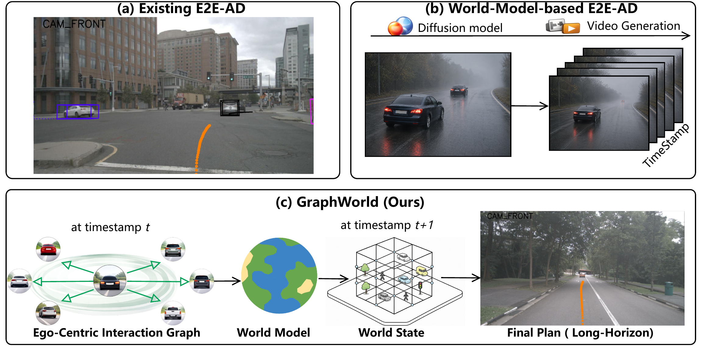
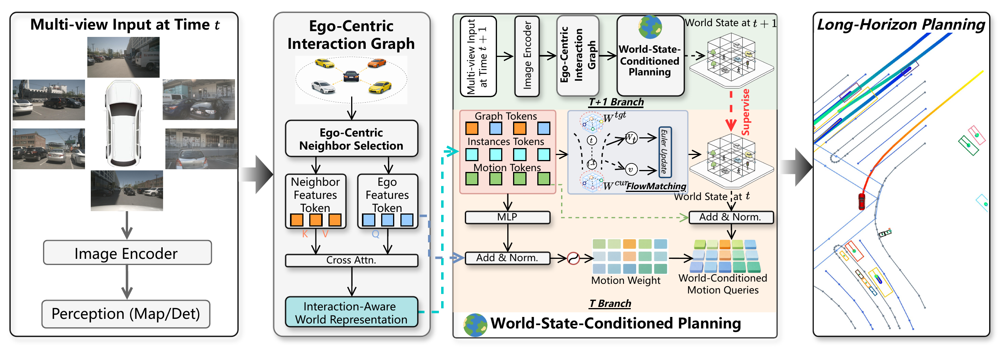
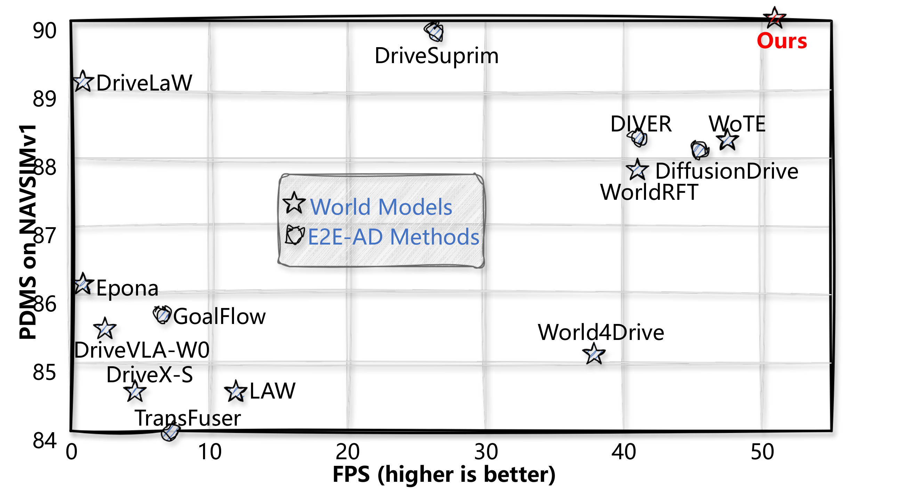
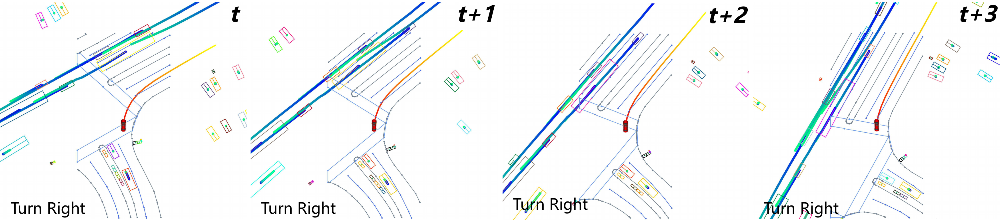
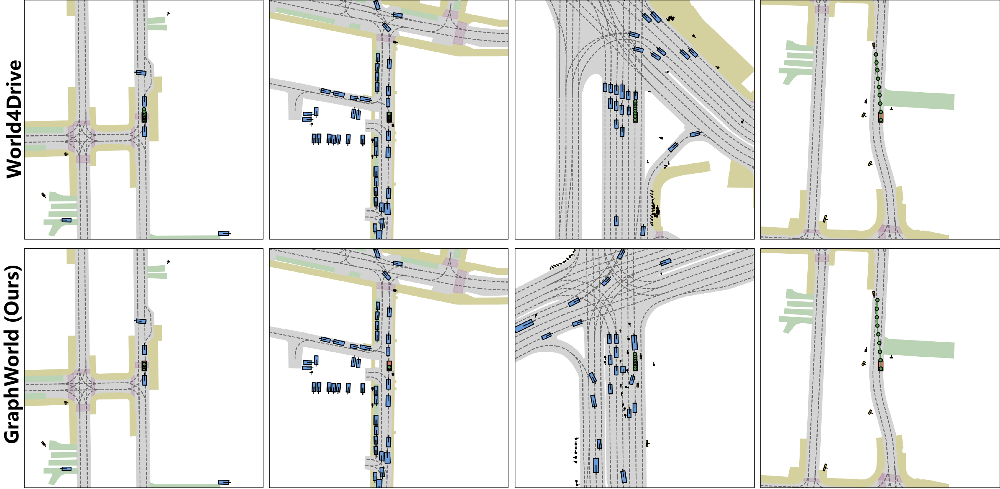
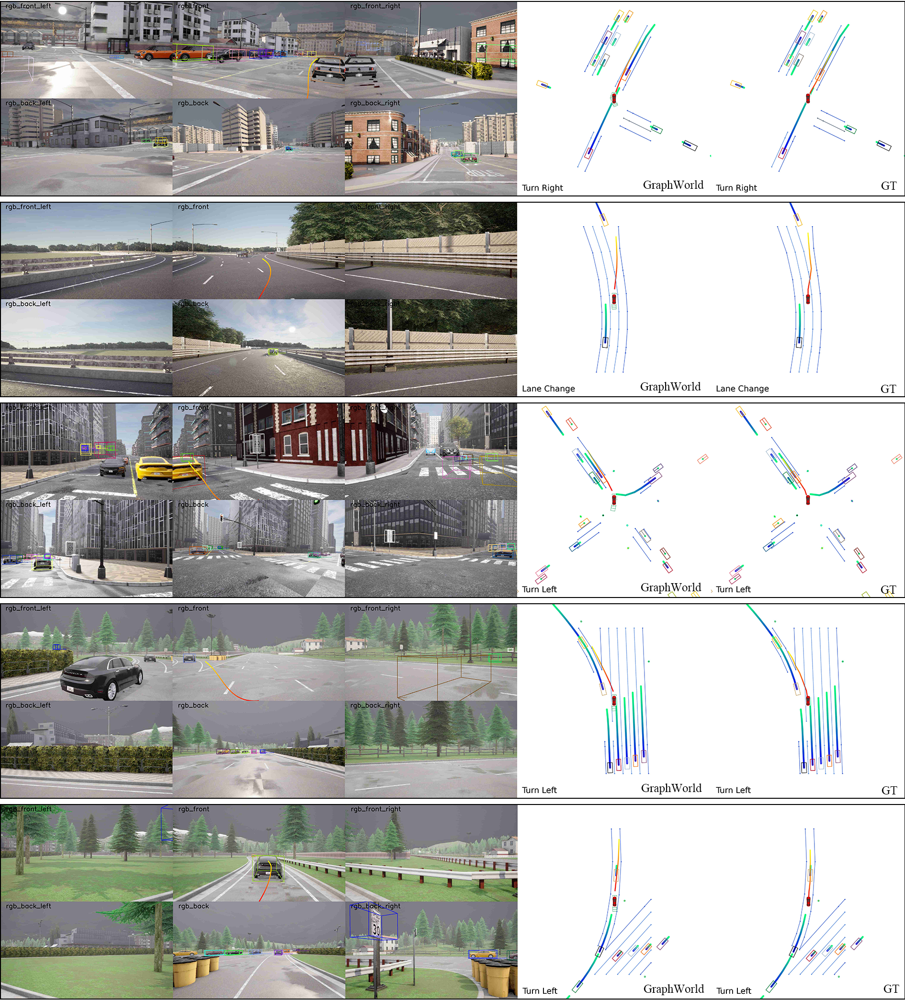

# GraphWorld

**Long-Horizon Planning with World Models for End-to-End Autonomous Driving**

GraphWorld studies how an ego-centric representation of nearby agents can support long-horizon planning. The paper combines an **Ego-Centric Interaction Graph (ECIG)** with **World-State-Conditioned Planning (WSCP)**: the graph identifies decision-relevant neighbors, and the resulting latent world state conditions agent motion hypotheses and the ego plan.

<p align="center">
  
</p>

## Paper overview

The paper proposes two connected components:

1. **ECIG** selects nearby agents and lets each ego planning hypothesis attend to their features. The interaction context forms an ego-centric latent world representation.
2. **WSCP** uses this representation to condition agent motion modes and ego planning queries. In the full paper, a temporal world encoder, conditional flow matching, and supervision from the next observed world state further refine the latent state.

<p align="center">
  
</p>

### Code status

The current release contains the available **nuScenes 3-second and 6-second GraphWorld implementation** from the SparseDrive workspace. It includes proximity-based neighbor selection, ego-to-neighbor cross-attention, latent world feature fusion, agent motion reweighting, and world-conditioned ego planning queries. The public configs, launch scripts, dataset converters, and evaluation code are included.

The provided source does **not** contain the paper's temporal GRU world encoder, conditional flow-matching branch, or second-stage `t+1` world-state supervision. The current neighbor selector uses a 5 m threshold and nine sampled indices; this also differs from the 10 m setting highlighted in the paper's neighbor-selection ablation. The tables below are **manuscript-reported results**, not independently reproduced by the released code. Trained GraphWorld checkpoints are not included in this release.

## Paper-reported results

### nuScenes open-loop planning

The 6-second nuScenes validation results below come from Table 1 of the manuscript. L2 is in meters; collision rate is a percentage. Lower is better.

| Method | L2@1s | @2s | @3s | @4s | @5s | @6s | Avg. L2 | Col.@1s | @2s | @3s | @4s | @5s | @6s | Avg. Col. |
| --- | ---: | ---: | ---: | ---: | ---: | ---: | ---: | ---: | ---: | ---: | ---: | ---: | ---: | ---: |
| SparseDrive | 0.43 | 0.87 | 1.23 | 1.75 | 2.32 | 2.95 | 1.59 | 0.19 | 0.31 | 0.56 | 0.87 | 1.54 | 2.33 | 0.97 |
| MomAD | 0.41 | 0.85 | 1.13 | 1.67 | 1.98 | 2.45 | 1.42 | 0.17 | 0.30 | 0.54 | 0.83 | 1.43 | 2.13 | 0.90 |
| World4Drive | 0.42 | 0.92 | 1.21 | 1.75 | 2.06 | 2.79 | 1.53 | 0.16 | 0.20 | 0.47 | 0.76 | 1.50 | 2.14 | 0.87 |
| **GraphWorld** | **0.38** | **0.70** | **1.12** | **1.64** | **1.88** | **2.29** | **1.34** | **0.03** | **0.06** | **0.25** | **0.65** | **1.29** | **1.95** | **0.70** |

For 3-second planning (Table 6), GraphWorld reports **0.57 m** average L2 and **0.08%** average collision rate. The 3-second motion prediction results (Table 7) are minADE **0.55**, minFDE **0.86**, miss rate **0.112**, and EPA **0.512**.

### Closed-loop benchmarks

| Benchmark and split | Paper-reported GraphWorld score | Metric |
| --- | ---: | --- |
| NAVSIM v1 NavTest | 90.1 | PDMS |
| NAVSIM v2 NavTest | 89.5 | EPDMS, corrected official evaluator |
| NAVSIM v2 NavHard | 53.6 | Two-stage EPDMS |
| Bench2Drive, SparseDrive-based setting | 51.55 / 25.47 | Driving Score / Success Rate (%) |
| Bench2Drive, ThinkTwice-based setting | 76.71 / 44.22 | Driving Score / Success Rate (%) |

These values are from the manuscript's Tables 2–5. The NAVSIM and Bench2Drive training and evaluation implementations are **not part of this nuScenes release**.

<p align="center">
  
</p>

## Qualitative results

The nuScenes visualization shows successive 6-second plans through a right turn. The NAVSIM figure compares GraphWorld with World4Drive; the Bench2Drive figure shows turns and a lane change alongside ground truth.

<p align="center">
  
</p>

<p align="center">
  
</p>

<p align="center">
  
</p>

## Released nuScenes code

The original server files were named `PlanWorld`. The published copies use `GraphWorld` names; the source workspace has not been renamed.

| Component | Path |
| --- | --- |
| 3-second experiment config | [`open_loop/projects/configs/GraphWorld_small_stage2.py`](open_loop/projects/configs/GraphWorld_small_stage2.py) |
| 6-second experiment config | [`open_loop/projects/configs/GraphWorld_small_stage2_6s.py`](open_loop/projects/configs/GraphWorld_small_stage2_6s.py) |
| 3-second planning head | [`open_loop/projects/mmdet3d_plugin/models/motion/motion_planning_head_GraphWorld.py`](open_loop/projects/mmdet3d_plugin/models/motion/motion_planning_head_GraphWorld.py) |
| 6-second planning head | [`open_loop/projects/mmdet3d_plugin/models/motion/motion_planning_head_GraphWorld_6s.py`](open_loop/projects/mmdet3d_plugin/models/motion/motion_planning_head_GraphWorld_6s.py) |
| Ego-centric graph and world feature fusion | [`open_loop/projects/mmdet3d_plugin/models/motion/worldmodelgraph.py`](open_loop/projects/mmdet3d_plugin/models/motion/worldmodelgraph.py) |
| Data preparation and anchors | [`open_loop/scripts/create_data.sh`](open_loop/scripts/create_data.sh), [`open_loop/scripts/kmeans.sh`](open_loop/scripts/kmeans.sh) |

The source workspace also contained `train_PlanWorld.sh`, `train_PlanWorld6s.sh`, and `test_PlanWorldy.sh`. Their public counterparts are the GraphWorld training and testing scripts in [`open_loop/scripts/`](open_loop/scripts/).

## Setup

The nuScenes code follows the SparseDrive/MomAD stack. A tested server environment uses Python 3.8, PyTorch 1.11.0 + CUDA 11.3, MMCV-Full 1.7.2, and MMDetection 2.28.2. From the repository root:

```bash
git clone https://github.com/modaxiansheng/GraphWorld.git
cd GraphWorld/open_loop

conda create -n graphworld python=3.8 -y
conda activate graphworld
pip install torch==1.11.0+cu113 torchvision==0.12.0+cu113 \
  torchaudio==0.11.0 --extra-index-url https://download.pytorch.org/whl/cu113
pip install -U openmim
mim install "mmcv-full==1.7.2"
pip install -r requirement.txt

cd projects/mmdet3d_plugin/ops
python setup.py develop
cd ../../..
```

Download the [nuScenes full dataset and CAN bus expansion](https://www.nuscenes.org/nuscenes#download). Link them under `open_loop/data/nuscenes/`, then generate the 3-second and 6-second annotations and anchors:

```bash
mkdir -p data
ln -s /path/to/nuscenes data/nuscenes
bash scripts/create_data.sh
bash scripts/kmeans.sh
```

Both configs use the same six-point planning anchor (`kmeans_plan_6.npy`); the 6-second head still predicts 12 future steps. This follows the source experiment setup.

The configs expect a compatible SparseDrive stage-two initialization checkpoint at `open_loop/ckpt/sparsedrive_stage2.pth`. It can be obtained from the [official SparseDrive release](https://github.com/swc-17/SparseDrive/releases/download/v1.0/sparsedrive_stage2.pth). The generated `data/` directory and model weights remain local.

## Training and evaluation

Run these commands from `open_loop/`. The published configs retain the source settings: batch size **48** across **8 GPUs**, with **40 epochs** for the 3-second config and **20 epochs** for the 6-second config. These are code defaults and should be distinguished from the manuscript's broader training protocol.

```bash
# Train
bash scripts/train_GraphWorld_3s.sh 8
bash scripts/train_GraphWorld_6s.sh 8

# Evaluate a checkpoint from the corresponding horizon
CUDA_VISIBLE_DEVICES=0,1,2,3 bash scripts/test_GraphWorld_3s.sh \
  /path/to/graphworld_3s.pth 4
CUDA_VISIBLE_DEVICES=0,1,2,3 bash scripts/test_GraphWorld_6s.sh \
  /path/to/graphworld_6s.pth 4

# Visualize the saved inference result
bash scripts/visualize.sh \
  work_dirs/GraphWorld_small_stage2_6s/results.pkl \
  vis_GraphWorld_6s 6s
```

No GraphWorld checkpoint is bundled with this code release. The manuscript figures and metrics should be treated as paper results until a matched checkpoint and complete evaluation log are published.

## Citation

The citation entry will be added when the paper becomes public.

## Acknowledgements and license

This nuScenes implementation builds on [SparseDrive](https://github.com/swc-17/SparseDrive) and [MomAD](https://github.com/adept-thu/MomAD). The dataset and evaluation tools come from the [nuScenes devkit](https://github.com/nutonomy/nuscenes-devkit). The code is released under the [MIT License](LICENSE).
